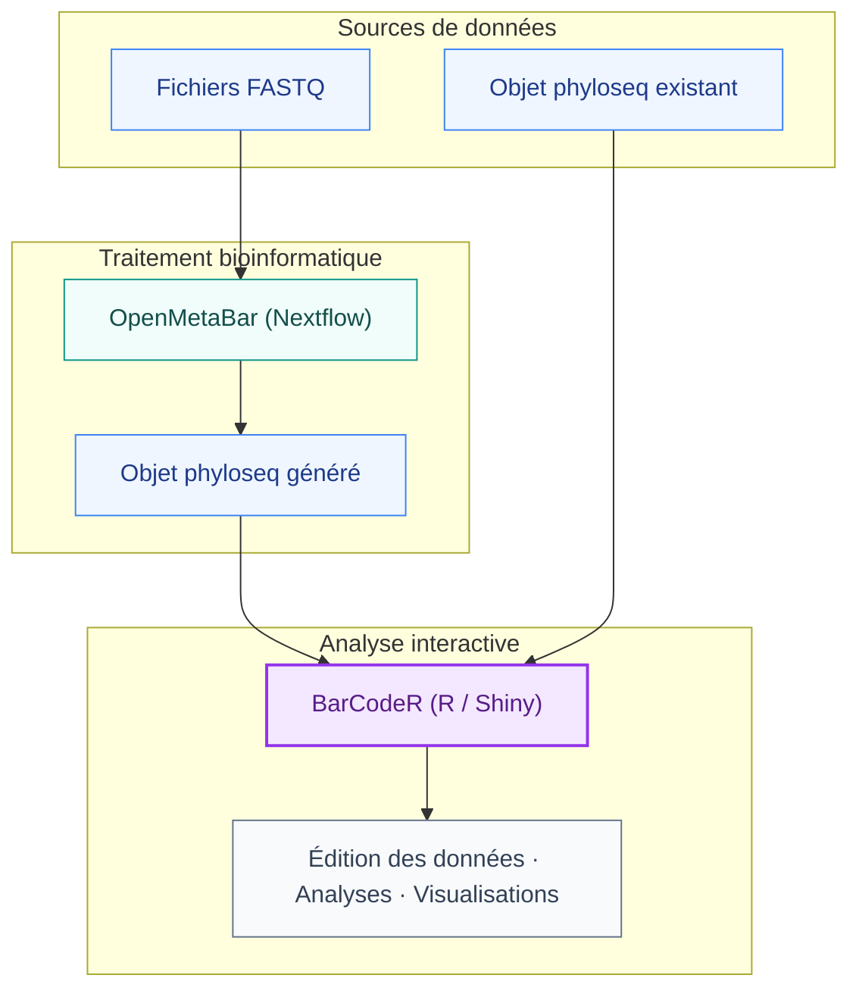
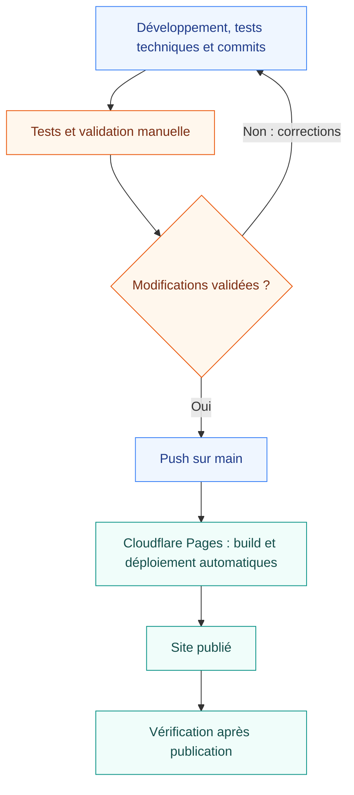

# BarCodeR — Site web

**Présentation · Documentation · Ressources**

Site web du projet **BarCodeR**, une application R/Shiny consacrée à l'exploration, à l'analyse et à la visualisation interactive de données de métabarcoding.

[**Consulter le site web**](https://site-barcoder-r-shiny-application.pages.dev/)

---

## À propos

Ce dépôt contient le code source du site web de BarCodeR. Il présente le fonctionnement de l'application, ses principales fonctionnalités et les ressources destinées à ses utilisateurs.

Le site web est distinct de l'application R/Shiny et du pipeline de traitement bioinformatique OpenMetaBar, qui constituent des composants indépendants du projet.

## Contenu du site

| Rubrique | Description |
| :--- | :--- |
| **Accueil** | Présentation de BarCodeR et de son écosystème. |
| **Fonctionnement** | Utilisation à partir de données `phyloseq` ou de fichiers FASTQ traités avec OpenMetaBar. |
| **Analyses** | Présentation des outils d'édition des données, des analyses statistiques et des visualisations interactives. |
| **Tutoriels** | Ressources de prise en main et exemples d'utilisation. |
| **Installation** | Téléchargement et installation de l'application. |
| **FAQ** | Réponses aux questions fréquentes. |

## Écosystème logiciel

- **OpenMetaBar** : traitement bioinformatique des données de séquençage.
- **BarCodeR** : importation, édition, exploration, analyses et visualisations interactives des données.
- **Ce site web** : présentation du projet, documentation, tutoriels et informations d'installation.

## Développement et déploiement

La [procédure de prépublication et de référencement](docs/PRELAUNCH_SEO.md) détaille le contrôle du ZIP Windows, les tests et la configuration de Google Search Console.

Le site est hébergé sur **Cloudflare Pages**. La publication est automatisée à partir de la branche `main` du dépôt.

Les évolutions du site sont développées à l'aide de Claude Code et de Codex, avec des tests techniques et des commits successifs. Les modifications sont ensuite contrôlées manuellement ; des corrections supplémentaires peuvent être demandées avant le `push` sur `main`.

Après le déploiement automatique, le rendu des pages, la navigation et les liens sont vérifiés.

La documentation, les captures d'écran et les liens de téléchargement sont maintenus en cohérence avec les versions publiées de BarCodeR et d'OpenMetaBar.

## Signaler un problème

Les erreurs de contenu, d'affichage ou de navigation peuvent être signalées dans les *Issues* de ce dépôt, lorsqu'elles sont activées. Les problèmes relatifs au fonctionnement de BarCodeR ou au traitement des séquences par OpenMetaBar doivent être adressés dans les dépôts correspondants.

## Licences

Le code source du site et ses contenus documentaires originaux relèvent de licences distinctes :

| Élément | Licence | Conditions principales |
| :--- | :--- | :--- |
| **Code source original du site** | [MIT](LICENSE) | Utilisation, modification et redistribution autorisées sous réserve de conserver les mentions de copyright et de licence. |
| **Contenus documentaires originaux** | [Creative Commons CC BY 4.0](LICENSE-CONTENT.md) | Reproduction, adaptation et exploitation commerciale autorisées avec attribution et indication des modifications. |

Les logos, marques, ressources tierces et éléments relevant d'une licence particulière ne sont pas automatiquement couverts par ces autorisations. Le périmètre et les exceptions sont détaillés dans [`LICENSE-CONTENT.md`](LICENSE-CONTENT.md).

**Titulaire des droits :** INRAE  
**Conception et développement du site :** Matéo Léger-Pigout  
**Année :** 2026

La diffusion sous ces licences doit être autorisée par les titulaires des droits et, le cas échéant, par les services institutionnels compétents. Ces licences concernent uniquement le site web ; celles de l'application **BarCodeR** et du pipeline **OpenMetaBar** sont indépendantes.

---

[Site web de BarCodeR](https://site-barcoder-r-shiny-application.pages.dev/)

